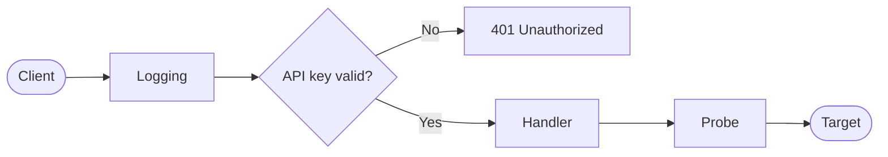

<div align="center">

# 🛰️ CheckHost Worker

**A small, self-hosted HTTP worker that checks whether a host is reachable and how fast it responds.**

Run one per location, then ask each over HTTP for an ICMP, TCP, UDP or HTTP measurement.

[](https://www.rust-lang.org)
[](https://github.com/tokio-rs/axum)
[](https://tokio.rs)

[Quick start](#-quick-start) •
[API](#-api) •
[Configuration](#%EF%B8%8F-configuration) •
[Logging](#-logging) •
[Development](#-development)

</div>

---

## ✨ Features

| | Probe | Route | Measures | Timeout |
|---|---|---|---|---|
| 📡 | **ICMP** | `GET /ping/{ip}` | Echo round trip to an IPv4 address | 2 s |
| 🔌 | **TCP** | `GET /tcp/{addr}` | Time to establish a connection | 5 s |
| 📨 | **UDP** | `GET /udp/{addr}` | Round trip of a DNS query datagram | 5 s |
| 🌐 | **HTTP** | `GET /http?addr={url}` | Time until response headers arrive | 10 s |

Every route requires an API key, and every request is logged without its query string, so the key stays out of the logs.

## 🚀 Quick start

**1. Configure the worker** by creating a `config.toml` in the directory you run it from:

```toml
[server]
port = 8080

[api]
key = "change-me"

[location]
city = "Paris"
country = "France"

[gateway]
host = "https://gateway.example.com/worker/health"
cooldown = 10
```

**2. Start it:**

```sh
cargo run --release
```

**3. Run a probe:**

```sh
curl "http://localhost:8080/tcp/example.com:443?key=change-me"
```

```json
{ "success": true, "address": "example.com:443", "elapsed_ms": 18 }
```

> [!IMPORTANT]
> ICMP probes need extra permissions. Without them, `/ping` returns `success: false`; the other probes are unaffected.
>
> | Platform | Requirement |
> |---|---|
> | Windows | Run as Administrator (uses a raw socket) |
> | Linux | The worker's group must be within `net.ipv4.ping_group_range` |
> | macOS | None |

## 📖 API

### How requests flow



### Authentication

Pass the API key as the `key` query parameter on every request.

| Situation | Status | Body |
|---|---|---|
| No key | `401` | `{ "error": "Missing API key" }` |
| Wrong key | `401` | `{ "error": "Invalid API key" }` |

> [!NOTE]
> A probe that fails still returns `200`. The request itself succeeded, so check the `success` field for the result.

### `GET /ping/{ip}`

Sends an ICMP echo request. `ip` must be an IPv4 address; hostnames are not accepted.

```sh
curl "http://localhost:8080/ping/1.1.1.1?key=change-me"
```

```json
{
  "ip": "1.1.1.1",
  "success": true,
  "rtt_ms": 12,
  "message": "OK",
  "location": "Paris, France"
}
```

On failure, `success` is `false`, `rtt_ms` is `0` and `message` holds the error.

### `GET /tcp/{addr}`

Opens a TCP connection to `addr`, given as `host:port`.

```sh
curl "http://localhost:8080/tcp/example.com:443?key=change-me"
```

### `GET /udp/{addr}`

Sends a DNS query for `www.google.com` to `addr` (`host:port`) and waits for any reply. Because the payload is a DNS query, this probe suits DNS servers best; other services may not answer it.

```sh
curl "http://localhost:8080/udp/1.1.1.1:53?key=change-me"
```

### `GET /http?addr={url}`

Sends a GET request to `url`. Any HTTP status, including `4xx` and `5xx`, counts as success; only failures such as DNS errors, refused connections and timeouts report `success: false`. Redirects are followed.

```sh
curl "http://localhost:8080/http?key=change-me&addr=https://example.com/"
```

> [!TIP]
> URL-encode `addr` if the target URL has its own query string, otherwise its `&` is read as part of the worker's query.

### Response format

The TCP, UDP and HTTP probes share one response shape:

<table>
<tr><th>✅ Success</th><th>❌ Failure</th></tr>
<tr>
<td>

```json
{
  "success": true,
  "address": "example.com:443",
  "elapsed_ms": 18
}
```

</td>
<td>

```json
{
  "success": false,
  "address": "example.com:444",
  "error": "deadline has elapsed"
}
```

</td>
</tr>
</table>

## ⚙️ Configuration

The worker reads `config.toml` from its working directory at startup and exits with an error if the file is missing or invalid.

| Key | Type | Description |
|---|---|---|
| `server.port` | integer | Port to listen on, on all interfaces |
| `api.key` | string | Key that clients must send |
| `location.city` | string | City shown in `/ping` responses |
| `location.country` | string | Country shown in `/ping` responses |
| `gateway.host` | string | URL that receives heartbeats |
| `gateway.cooldown` | integer | Seconds between heartbeats, at least `1` |

> [!CAUTION]
> Treat `api.key` as a secret and don't commit a real one. Anyone holding the key can make the worker send requests to any address, including services on its internal network, so don't expose it publicly without restricting access.

## 💓 Gateway heartbeat

Once the server is listening, the worker sends a `POST` to `gateway.host` immediately and then every `gateway.cooldown` seconds:

```json
{ "ip": "203.0.113.10", "city": "Paris", "country": "France" }
```

A failed heartbeat, including a non-`2xx` response, is logged as a warning and retried on the next tick.

> [!NOTE]
> `ip` is the address of the network interface used to reach the gateway. Behind NAT, this is the private address rather than the public one.

## 📊 Logging

Logs go to stdout. The level defaults to `info` and can be changed with `RUST_LOG`:

```sh
RUST_LOG=check_host_worker=debug cargo run
```

Each request gets a span with its method, path and client address:

```text
INFO request{method=GET path=/tcp/1.1.1.1:443 client="10.0.0.5:28868"}: check_host_worker::handlers: probe succeeded probe="tcp" target=1.1.1.1:443 elapsed_ms=14
INFO request{method=GET path=/tcp/1.1.1.1:443 client="10.0.0.5:28868"}: check_host_worker::middleware::logging: request completed status=200 latency_ms=14
WARN request{method=GET path=/ping/1.1.1.1 client="10.0.0.9:47648"}: check_host_worker::middleware::auth: rejected request: invalid API key
```

| Level | Used for |
|---|---|
| `ERROR` | Requests that end in a `5xx` response |
| `WARN` | Failed probes and heartbeats, rejected keys and other `4xx` responses |
| `INFO` | Startup, successful probes and completed requests |
| `DEBUG` | Sent heartbeats, UDP reply details and HTTP status codes |
| `TRACE` | Unrelated ICMP packets that were ignored |

## 🛠️ Development

```sh
cargo clippy --all-targets    # lints
cargo fmt                     # formatting
```

<details>
<summary><strong>📁 Project structure</strong></summary>

```text
src/
├── main.rs            Startup
├── lib.rs             Module declarations
├── app.rs             Router and shared state
├── config.rs          config.toml loading
├── gateway.rs         Gateway heartbeat
├── telemetry.rs       Log setup
├── handlers.rs        Route handlers and response types
├── middleware/
│   ├── auth.rs        API key check
│   └── logging.rs     Request logging
└── probes/
    ├── icmp.rs
    ├── tcp.rs
    ├── udp.rs
    └── http.rs
```

</details>
